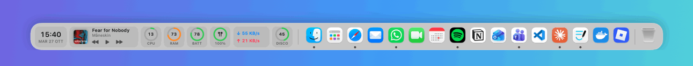
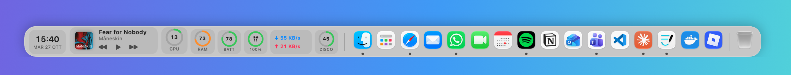
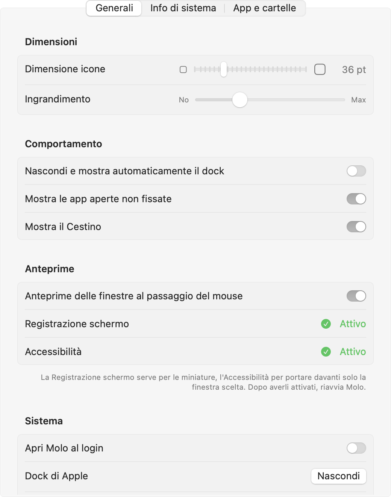
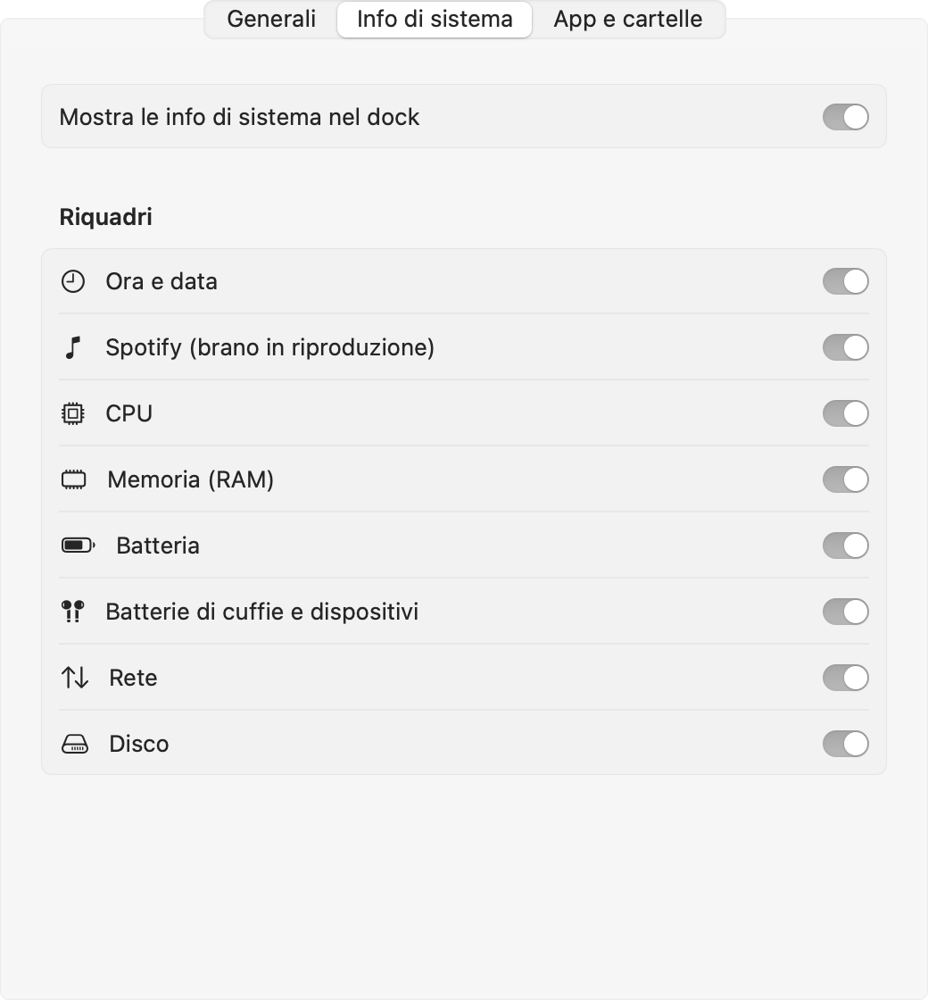
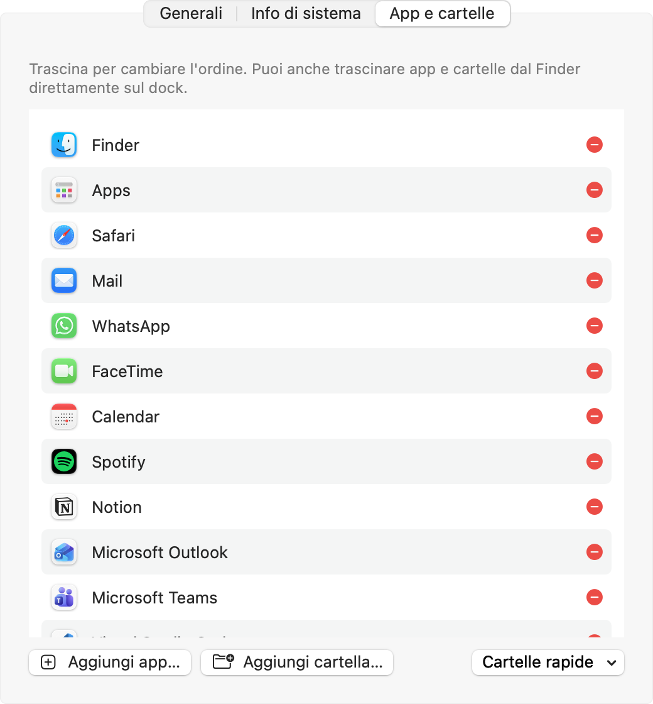

# Molo

**Un dock alternativo per macOS, con widget di sistema, Spotify e batterie delle cuffie.**
*An alternative macOS Dock with system widgets, Spotify and headphone battery — docs in Italian.*



Molo prende il posto del Dock di Apple: tiene le tue app, le app aperte e il Cestino, e in più mostra a colpo d'occhio ora, CPU, RAM, batteria, rete, disco, il brano di Spotify e la carica delle AirPods. Ingrandimento "a onda" su icone e widget, anteprime delle finestre, rimbalzo all'avvio e animazioni come il Dock originale.

---

## Indice

1. [Cosa fa](#cosa-fa)
2. [Requisiti](#requisiti)
3. [Installazione](#installazione)
4. [Togliere il Dock di Apple](#togliere-il-dock-di-apple)
5. [Rimettere il Dock di Apple](#rimettere-il-dock-di-apple)
6. [Impostazioni](#impostazioni)
7. [Permessi richiesti](#permessi-richiesti)
8. [Batteria dell'iPhone (opzionale)](#batteria-delliphone-opzionale)
9. [Disinstallare Molo](#disinstallare-molo)
10. [Problemi comuni](#problemi-comuni)
11. [Limiti noti](#limiti-noti)

---

## Cosa fa


**Widget (a sinistra)**
| Riquadro | Cosa mostra | Al click apre |
|---|---|---|
| Ora e data | ora, giorno, mese | Calendario |
| Spotify | copertina, titolo, artista, ⏮ ⏯ ⏭ | Spotify |
| CPU / RAM / Disco | anello con la percentuale d'uso | Monitoraggio Attività / Utility Disco |
| Batteria | carica del Mac, ⚡ quando è in carica | Impostazioni Batteria |
| Dispositivi | AirPods (sinistra, destra, custodia), cuffie, mouse, tastiere Bluetooth | Impostazioni Bluetooth |
| Rete | velocità di download e upload | Monitoraggio Attività |

Passa il mouse su un riquadro per vedere i dettagli. Anche i widget partecipano all'onda di ingrandimento:



**App (al centro e a destra)**
- Al primo avvio importa quello che avevi nel Dock di Apple: le app fissate, nello stesso ordine, e le cartelle della parte destra (Download, Documenti…). Le app disinstallate vengono saltate.
- Dopo un separatore ci sono le app aperte non fissate. Il pallino sotto un'icona indica che l'app è aperta.
- **Trascina** un'app o una cartella dal Finder sul dock per fissarla.
- **Trascina** un'icona sopra un'altra per cambiare l'ordine.
- **Trascina** dei file su un'icona per aprirli con quell'app, oppure sul Cestino per eliminarli.
- **Tasto destro** su un'icona: rimuovi dal dock, mostra nel Finder, nascondi, esci, uscita forzata.
- **Anteprime delle finestre**: tieni il mouse fermo su un'app aperta e sopra l'icona compaiono le miniature delle sue finestre. Clicca una miniatura per portare davanti quella finestra. Spostandoti su un'altra icona l'anteprima cambia subito. Servono i permessi di Registrazione schermo e Accessibilità (vedi [Permessi](#permessi-richiesti)).
- Se le icone non entrano nello schermo, si rimpiccioliscono da sole.
- Al passaggio del mouse le icone si ingrandiscono "a onda", come nel Dock di Apple:


---

## Requisiti

- macOS 14 Sonoma o successivo (Apple Silicon o Intel)
- Gli **Strumenti da riga di comando di Xcode** (servono per compilare). Se non li hai, apri il Terminale ed esegui:
  ```bash
  xcode-select --install
  ```
  Si apre una finestra: clicca **Installa** e aspetta qualche minuto.

---

## Installazione

Apri il **Terminale** (Spotlight → scrivi "Terminale") ed esegui questi comandi, uno alla volta:

```bash
git clone https://github.com/Bargi20/Molo.git
cd Molo
./scripts/build-app.sh --install
```

Lo script compila Molo, lo copia in `~/Applications/Molo.app` e lo avvia. In fondo allo schermo compare il nuovo dock.

> Molo viene compilato sul tuo Mac, quindi macOS non mostra l'avviso "sviluppatore non identificato".

Per aggiornarlo in futuro:

```bash
cd Molo
git pull
./scripts/build-app.sh --install
```

---

## Togliere il Dock di Apple

Il Dock di Apple fa parte di macOS e **non si può disinstallare**. Quello che si può fare è nasconderlo in modo che non ricompaia mai: si attiva il "nascondi automaticamente" con un ritardo di 1000 secondi. È un'impostazione normale di macOS, sicura e reversibile in qualsiasi momento.

Scegli **uno** di questi metodi.

### Metodo 1: dal menu di Molo (il più semplice)

1. Fai **clic con il tasto destro** su una zona vuota del dock di Molo (non sopra un'icona).
2. Scegli **Nascondi il Dock di Apple**.

Lo trovi anche in **Impostazioni → Generali → Dock di Apple → Nascondi**.

### Metodo 2: con lo script

Dalla cartella `Molo` nel Terminale:

```bash
./scripts/apple-dock.sh hide
```

### Metodo 3: a mano dal Terminale

```bash
defaults write com.apple.dock autohide -bool true
defaults write com.apple.dock autohide-delay -float 1000
killall Dock
```

Cosa fanno:
- `autohide -bool true`: attiva "Nascondi e mostra automaticamente il Dock".
- `autohide-delay -float 1000`: aspetta 1000 secondi prima di mostrarlo quando porti il mouse in basso, quindi in pratica non compare mai.
- `killall Dock`: riavvia il Dock per applicare le modifiche. Non chiude nessuna app.

### Consiglio: fai partire Molo all'accensione

Dal tasto destro sul dock di Molo → **Apri al login**, oppure **Impostazioni → Generali → Apri Molo al login**. Così al riavvio del Mac ti ritrovi subito Molo al posto del Dock.

---

## Rimettere il Dock di Apple

Anche qui, uno dei metodi:

- **Dal menu di Molo**: tasto destro sul dock → **Ripristina il Dock di Apple**.
- **Con lo script**:
  ```bash
  ./scripts/apple-dock.sh restore
  ```
- **A mano**:
  ```bash
  defaults delete com.apple.dock autohide-delay
  defaults write com.apple.dock autohide -bool false
  killall Dock
  ```
- **In emergenza**: premi **⌘ ⌥ D** (Command + Option + D) per mostrare o nascondere al volo il Dock di Apple.

Il ripristino dal menu di Molo rimette il Dock com'era prima (sempre visibile o a scomparsa).

---

## Impostazioni

Tasto destro su una zona vuota del dock → **Impostazioni…**. Si aprono anche rilanciando Molo da Spotlight.

<table>
  <tr>
    <td align="center"><br><sub>Generali</sub></td>
    <td align="center"><br><sub>Info di sistema</sub></td>
    <td align="center"><br><sub>App e cartelle</sub></td>
  </tr>
</table>

- **Generali**
  - dimensione delle icone (24–72 pt) e quanto si ingrandiscono al passaggio del mouse
  - nascondi automaticamente il dock
  - mostra le app aperte e il Cestino
  - anteprime delle finestre, con lo stato dei due permessi e un pulsante per attivarli
  - apri al login, nascondi o ripristina il Dock di Apple, esci
- **Info di sistema**: scegli quali riquadri mostrare.
- **App e cartelle**: riordina, rimuovi, aggiungi app o cartelle. C'è anche un pulsante rapido per Download, Documenti e Scrivania.

---

## Permessi richiesti

| Quando | Richiesta | Perché |
|---|---|---|
| Primo avvio con Spotify aperto | "Molo vuole controllare Spotify" | Leggere la copertina e usare ⏮ ⏯ ⏭. Se rifiuti, il widget mostra comunque titolo e artista. |
| Primo passaggio su un'app aperta | Registrazione schermo | Fare le miniature delle finestre nelle anteprime. Molo non registra niente: cattura solo le finestre dell'app sotto il mouse, nel momento in cui compare l'anteprima. |
| Primo clic su una miniatura | Accessibilità | Portare davanti solo la finestra scelta. Senza, Molo porta davanti l'app con tutte le sue finestre. |
| "Apri al login" | (nessuna finestra, compare in Impostazioni di Sistema → Generali → Elementi login) | Avviare Molo all'accensione. |

Se hai rifiutato per sbaglio il permesso di Spotify, riattivalo da **Impostazioni di Sistema → Privacy e sicurezza → Automazione → Molo → Spotify**.

Registrazione schermo e Accessibilità si attivano in **Impostazioni di Sistema → Privacy e sicurezza**, oppure da **Impostazioni di Molo → Generali → Anteprime**. Dopo averli attivati, esci da Molo e riaprilo. Se non vuoi dare questi permessi, spegni le anteprime nella stessa sezione.

---

## Batteria dell'iPhone (opzionale)

macOS non permette alle app di leggere la batteria dell'iPhone. Molo la mostra se installi lo strumento gratuito **libimobiledevice**, con [Homebrew](https://brew.sh):

```bash
brew install libimobiledevice
```

Poi collega l'iPhone al Mac con il cavo, sbloccalo e tocca **Autorizza**. Da quel momento Molo lo mostra quando è collegato via cavo. A volte funziona anche in Wi-Fi, se l'iPhone è sulla stessa rete.

---

## Disinstallare Molo

1. Rimetti il Dock di Apple (vedi [sopra](#rimettere-il-dock-di-apple)).
2. Tasto destro sul dock di Molo → **Esci da Molo**. Se avevi attivato "Apri al login", disattivalo prima.
3. Elimina l'app e le sue preferenze:
   ```bash
   rm -rf ~/Applications/Molo.app
   defaults delete local.molo.dock
   ```

---

## Problemi comuni

**Vedo due dock uno sopra l'altro.**
Non hai ancora nascosto il Dock di Apple: vedi [Togliere il Dock di Apple](#togliere-il-dock-di-apple).

**Il dock è troppo grande o troppo piccolo.**
Apri **Impostazioni → Generali → Dimensione icone**. Se ci sono tanti widget, prova a toglierne qualcuno in **Info di sistema**.

**Le finestre a schermo intero finiscono sotto il dock.**
Attiva **Nascondi automaticamente**: il dock scompare e ricompare quando porti il mouse sul bordo inferiore dello schermo.

**Il widget di Spotify non compare.**
Compare solo quando Spotify è aperto e c'è un brano caricato. Controlla anche il permesso in Automazione (vedi [Permessi](#permessi-richiesti)).

**Le AirPods non compaiono.**
Il riquadro appare solo quando sono collegate al Mac. Si aggiorna ogni 20 secondi.

**Le anteprime non compaiono.**
Compaiono solo per le app aperte con almeno una finestra visibile nella Scrivania attuale (le finestre ridotte a icona non hanno miniatura). Controlla in **Impostazioni → Generali → Anteprime** che Registrazione schermo risulti "Attivo", poi riavvia Molo.

**`xcrun: error: invalid active developer path`**
Mancano gli strumenti di Xcode: esegui `xcode-select --install`.

---

## Limiti noti

- Niente badge delle notifiche.
- Le anteprime mostrano solo le finestre visibili nella Scrivania attuale, non quelle ridotte a icona o in altre Scrivanie.
- Il dock compare solo sullo schermo principale.
- Il Dock di Apple resta attivo in background: Molo lo nasconde, non lo sostituisce a livello di sistema.

---

## Per sviluppatori

Swift Package con SwiftUI + AppKit, nessuna dipendenza esterna.

```bash
swift build                       # compila (debug)
swift test                        # esegue i test
.build/debug/Molo                 # avvia senza creare la .app
./scripts/build-app.sh            # crea build/Molo.app
```

### Rigenerare le immagini del README

Le immagini in `docs/images` sono fatte da Molo stesso, senza bisogno di permessi di registrazione schermo:

```bash
.build/debug/Molo --record /tmp/molo-frames                   # fotogrammi del puntatore che scorre
swift scripts/readme-media.swift /tmp/molo-frames docs/images  # dock.png, dock-wave.png, dock-widgets.png, dock.gif
.build/debug/Molo --snapshot docs/images/settings-generali.png --settings 0   # 1 e 2 per le altre schede
```

| File | Cosa contiene |
|---|---|
| `DockController.swift` | finestra, posizione, auto-nascondi, tracciamento del mouse |
| `DockView.swift` | barra, icone, ingrandimento a onda, menu |
| `SystemWidgets.swift` | riquadri dei widget |
| `SystemMonitor.swift` | CPU, RAM, batteria, rete, disco |
| `SpotifyMonitor.swift` | brano di Spotify e comandi |
| `DeviceBatteryMonitor.swift` | batterie Bluetooth e iPhone |
| `AppsModel.swift` | app fissate e in esecuzione |
| `WindowPreviews.swift` | anteprime delle finestre |
| `SettingsView.swift` | finestra Impostazioni |
| `Tests/MoloTests` | test dell'importazione dal Dock di Apple |

## Licenza

[MIT](LICENSE)
